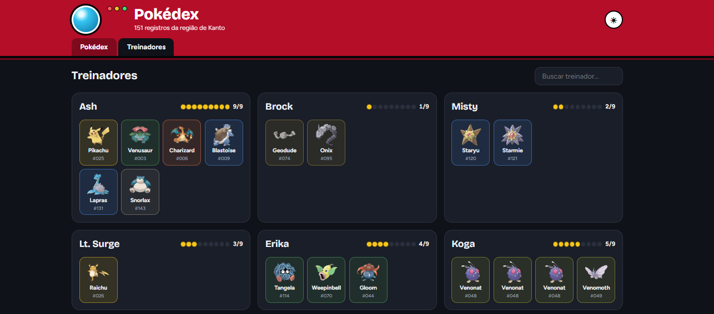
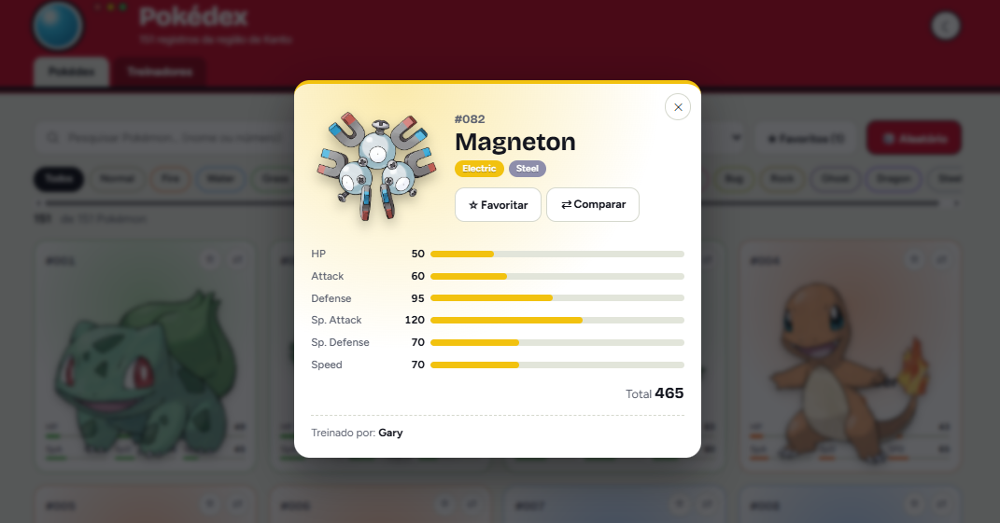

# Pokédex React + Vite 🎮

## 📖 Descrição

Pokédex interativa feita com **React** e **Vite** para a Atividade 03. A aplicação lê o arquivo `pokedex-data.json` (151 Pokémon, 18 tipos e 12 treinadores) e exibe tudo em uma **tela única** com duas abas: **Pokédex** e **Treinadores**. Não existe back-end, banco de dados nem chave de API.


## Integrantes: Gabriela Campelo Costa

## 🖼️ Capturas de Tela






## 🚀 Como rodar

```bash
npm install
npm run dev
```

Acesse `http://localhost:5173`.

Outros comandos:

```bash
npm run build     # gera a versão de produção em dist/
npm run preview   # serve a versão de produção
npm run lint      # oxlint
```

## ✅ Funcionalidades

**Obrigatórias**

- 🐾 Lista com todos os Pokémon: número, nome, tipos, HP, Attack, Defense, Sp. Attack, Sp. Defense e Speed.
- 🔎 Pesquisa por **nome** ou **ID**, atualizada a cada tecla (aceita `Bulba`, `25` e `#025`; ignora acentos e maiúsculas).
- 🧬 Filtro por **tipo** (botões gerados a partir dos tipos do JSON).
- 📄 **Detalhes** em modal, com barras de atributos, total e treinadores do Pokémon.
- 🧑‍🚀 Aba **Treinadores**: nome, insígnias e os Pokémon de cada um (clicar abre os detalhes).
- ⚠️ Mensagem quando nada é encontrado, com botão para limpar os filtros.
- 📱 Layout responsivo e identidade visual própria (casco vermelho, lente azul, cores por tipo).

**Desafios opcionais implementados**

- ⭐ **Favoritos** (salvos no `localStorage`, com filtro "só favoritos").
- ⚔️ **Comparação** de dois Pokémon lado a lado.
- 📊 **Ordenação** por número, nome, total e cada atributo.
- 🎲 **Pokémon aleatório**.
- 🌙 **Dark mode** (respeita o tema do sistema e lembra a escolha).

## 📁 Onde estão os dados

`src/data/pokedex-data.json`, importado apenas por `src/services/pokedexService.js`. Nenhum componente lê o JSON diretamente.

## 🧩 Organização do projeto

```text
src/
├── components/
│   ├── Header/            # lente, título, abas e botão de tema
│   ├── SearchBar/         # campo de pesquisa
│   ├── TypeFilter/        # botões de filtro por tipo
│   ├── PokemonList/       # grade de cards (map)
│   ├── PokemonCard/       # card com os 6 atributos
│   ├── PokemonDetails/    # modal de detalhes
│   ├── CompareModal/      # comparação de dois Pokémon
│   ├── TrainerList/       # aba de treinadores
│   ├── StatBar/           # barra de atributo
│   ├── TypeBadge/         # selo de tipo
│   └── EmptyState/        # "nenhum resultado"
├── hooks/
│   ├── usePersistentState.js  # useState + localStorage
│   └── useTema.js             # tema claro/escuro
├── services/
│   └── pokedexService.js      # busca, filtro, ordenação e helpers
├── data/pokedex-data.json
├── App.jsx / App.css
├── main.jsx
└── index.css                  # variáveis de tema, botões e modal
```

Cada componente fica em uma pasta com seu `.jsx` e seu `.css`.

## ⚛️ Conceitos de React usados

| Conceito | Onde |
|---|---|
| Componentes funcionais e **props** | todos os componentes em `components/` |
| **`useState`** | `App.jsx` (busca, tipo, ordem, aba, seleção, comparação) |
| **`useEffect`** | `PokemonDetails`, `CompareModal` (tecla Esc) e `useTema` |
| **`useMemo` / estado derivado** | `App.jsx` calcula a lista exibida a partir de busca + tipo + favoritos + ordem |
| **`useCallback`** | handlers passados por props em `App.jsx` |
| **Hooks personalizados** | `usePersistentState`, `useTema` |
| Renderização de listas com **`map()`** | `PokemonList`, `TypeFilter`, `TrainerList`, `StatBar` |
| **Eventos** | `onChange`, `onClick`, `onKeyDown`/`keydown`, `onError` |
| Renderização condicional | modais, estado vazio, abas |

## 🖼️ Imagens dos Pokémon

As imagens vêm do repositório público de sprites da **PokéAPI** (uso opcional):

```text
https://raw.githubusercontent.com/PokeAPI/sprites/master/sprites/pokemon/other/official-artwork/{id}.png
```

O `{id}` é o número do Pokémon no `pokedex-data.json`. **A Pokédex funciona sem as imagens**: se uma imagem não carregar (ou se estiver sem internet), o card mostra uma Pokébola no lugar. Todas as informações vêm do JSON local.

Fonte: [PokeAPI/sprites](https://github.com/PokeAPI/sprites). Os personagens pertencem à Nintendo/Game Freak, e o uso aqui é apenas educacional.

## 🔑 Dependências

- `react` e `react-dom`
- `vite` e `@vitejs/plugin-react`
- `oxlint` (lint)

Fontes (Google Fonts): Bricolage Grotesque e Figtree.
